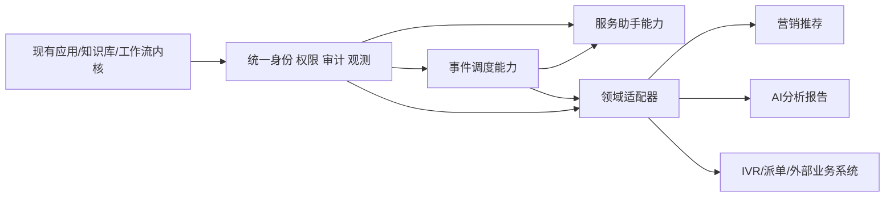

# 线上营销智能体平台建设：分步开发、验收与操作手册

> 版本：v1.0　日期：2026-08-31　适用代码基线：当前仓库 `7f09470 feat: 建设修改`
>
> 本文是可执行的研发计划，不是对建设方案的再次改写。每个阶段都必须完成：开发 → 自检 → 联调 → 验收 → 操作文档 → 才能进入下一阶段。

## 1. 重新扫描后的结论

### 1.1 扫描范围与证据

本次结论基于以下材料和代码扫描：

| 来源 | 结论 |
| --- | --- |
| `docs/建设文档适配评估与PRD规划.md` | 作为历史规划参考，但其中部分目录判断已过时。 |
| `docs/建设方案参考材料/线上营销智能体平台建设功能对比.xlsx` | 39 行功能对比；覆盖营销推荐、服务助手、智能体调度、模型/知识库、AI 分析报告。 |
| `docs/建设方案参考材料/中国电信2026年理想公司线上营销智能体平台建设研发工程项目-建设方案-20260527_v3.0.docx` | 目标要求还包含 IVR、模拟预演、上云、安全三同步、性能指标和实施里程碑。 |
| 当前仓库 | 后端约 1057 个 Python 文件、前端约 827 个 TS/Vue 文件、61 个迁移文件、40 个工作流节点；已有 Docker、本地模型、Celery、PostgreSQL/pgvector、Redis。 |

已执行的基线检查：

```text
.venv/bin/python -m compileall -q apps main.py       PASS
cd ui && pnpm type-check                             PASS
git status --short                                   CLEAN（扫描时）
```

当前不足：各业务 `tests.py` 存在但多数为空壳，尚未形成端到端测试门禁；因此本计划把测试、数据迁移、回滚和操作说明作为每个功能的强制产物。

### 1.2 现有能力重新归类

| 建设域 | 当前可复用代码 | 当前状态 | 处理方式 |
| --- | --- | --- | --- |
| 服务助手 | `apps/knowledge/`、`apps/application/flow/`、`apps/models_provider/`、`ui/src/workflow/nodes/` | 知识库、文档、分段、embedding、混合检索、reranker、RAG 工作流已有 | 优先补评估、合规、版本和可观测性，不重写对话主链路 |
| 应用与对话 | `apps/application/`、`apps/chat/`、`ui/src/views/application/`、`ui/src/views/chat/` | 应用版本、API Key、访问令牌、聊天记录、SSE/兼容接口已有 | 增加统一领域事件、审计和质量反馈 |
| 工具与编排 | `apps/tools/`、`apps/application/flow/`、`apps/trigger/` | 工具、MCP、工作流、定时/webhook 触发、执行记录已有 | 从单应用工作流逐步抽象为事件/任务调度中心 |
| 权限与安全 | `apps/users/`、`apps/system_manage/`、`apps/xpack_lite/` | RBAC、对话用户、用户组、资源授权、操作日志、钉钉基础对接已有 | 补授权策略、审计、双因素、脱敏和密钥治理 |
| 模型底座 | `apps/models_provider/`、`apps/local_model/` | 多厂商 LLM/Embedding/Reranker/STT/TTS/视觉模型接入已有 | 先统一模型调用观测，再做评估/注册/发布，不先引入完整 MLflow |
| 异步与部署 | `apps/ops/`、`apps/knowledge/task/`、`docker/`、`main.py` | Celery/Celery Beat、Redis、本地模型和 Docker 启动已有 | 补任务幂等、告警、备份恢复、云资源配置和压测 |
| 营销推荐/报告/IVR/预演 | 当前无完整业务闭环 | 目标与现状差距最大 | 先做契约和 Spike，再采用适配器/旁路服务，禁止直接改造对话核心 |

### 1.3 总体判断

目标平台不能按“一个 Django 项目一次性改成完整营销系统”实施。建议采用“稳定平台内核 + 可插拔领域服务 + 统一事件和审计”的方式：



## 2. 交付规则：做完一步，检查一步，写一步

每个开发步骤必须提交以下 8 项，缺一项不算完成：

1. 代码：后端 API/任务/模型、前端页面/权限、迁移文件。
2. 契约：请求/响应 JSON Schema、事件 schema、错误码、幂等键。
3. 测试：单元测试、API 测试、至少 1 条浏览器或接口验收脚本。
4. 数据：初始化数据、迁移、索引、数据量和保留周期说明。
5. 可观测性：日志字段、耗时、成功率、trace_id、业务指标。
6. 回滚：代码开关、数据库回滚、数据补偿、旧链路恢复方式。
7. 验收记录：环境、账号、输入数据、实际结果、截图/日志位置。
8. 操作文档：管理员配置、业务人员使用、失败处理、权限要求。

### 2.1 统一验收模板

每个功能目录建议包含：

```text
docs/ops/<功能编号>-<功能名>-操作文档.md
tests/<功能编号>/test_*.py 或 ui/e2e/<功能编号>/*.spec.ts
docs/acceptance/<功能编号>-验收记录.md
```

操作文档固定包含：目的、前置条件、角色权限、配置步骤、正常操作、异常处理、数据查看、回滚/停用、常见问题、版本记录。

## 3. 分阶段开发路线

### 阶段 0：现状冻结与研发门禁（P0）

目标：先建立可重复的开发、测试、发布基线。

开发任务：

- 固化 `main.py` 的 web、celery、local_model 三种运行方式和环境变量清单。
- 建立 API 契约目录，标明 `/admin/api/*` 与 `/chat/api/*` 的稳定接口。
- 建立测试数据：管理员、普通运营员、对话用户、用户组、知识库、应用、工具、触发器。
- 为每个新模块建立迁移、日志、指标和 feature flag 约定。
- 增加 CI 门禁：Python 编译/ruff、前端 type-check/build、API 冒烟、迁移检查。

检查门禁：

- 新环境可按 README 启动 web、worker、local_model；健康检查可用。
- 现有应用创建、发布、聊天、知识库导入/检索、工具调试、触发器执行各有一条可复现冒烟用例。
- `compileall`、`pnpm type-check`、前端构建、迁移检查全部通过。

操作文档：`0-环境初始化与基线验收`。必须写清 `.env.local`、数据库/Redis、本地模型、启动命令、默认账号修改、日志位置和清理测试数据方式。

### 阶段 1：统一身份、权限、审计与合规屏障（P0）

目标：在所有新能力之前建立安全边界。

开发顺序：

1. 统一用户来源和主体 ID：本地、钉钉、API 调用方统一映射。
2. 明确“工作空间—用户组—应用/知识库/工具/报告”的授权矩阵。
3. 增加敏感词、禁答规则、数据脱敏、回答后审核和人工复核状态。
4. 扩展操作日志：主体、资源、动作、结果、IP、trace_id、前后值摘要。
5. 增加双因素认证和失败锁定；密钥只存密文或引用密钥服务。

检查门禁：

- 未授权用户不能通过页面、API、分享链接、工具调用绕过资源权限。
- 禁答命中、敏感词命中、模型异常均有可解释错误码和审计记录。
- 管理员能按用户、资源、时间查询审计记录；敏感字段展示已脱敏。
- 关闭 feature flag 后，旧认证/回答链路可恢复。

操作文档：

- `1-用户与用户组授权操作文档`：创建用户组 → 加入用户 → 授权应用/知识库 → 验证访问 → 撤权。
- `1-内容合规审核操作文档`：维护词库/规则 → 配置审核策略 → 测试命中 → 人工复核 → 查看统计。
- `1-双因素认证与审计操作文档`：启用、应急管理员、锁定解锁、审计导出和密钥轮换。

### 阶段 2：服务助手知识库增强与 RAG 评估（P0）

目标：把已有“能导入、能检索、能回答”提升为“可解释、可评估、可发布、可回滚”。

开发顺序：

1. 文档解析策略：文件类型、标题层级、表格、图片 OCR、递归/标题感知分段。
2. 索引任务状态：排队、解析、分段、向量化、发布、失败、取消；沿用 Celery/Celery Once 的幂等思想。
3. 检索结果展示：向量分、关键词分、融合分、reranker 分、来源段落和版本。
4. 评估集：问题、期望文档/段落、参考答案、人工标签、评估版本。
5. 知识库索引版本：构建新版本 → 灰度 → 发布 → 一键回滚。
6. 回答质量反馈：点赞/点踩、纠错、无答案、引用缺失进入待处理池。

检查门禁：

- 同一个文档重复提交不会生成重复索引；中断后可恢复或明确失败。
- 评估集能输出 Recall@K、MRR、无答案率、引用覆盖率；每次参数修改可对比。
- 发布新索引不影响旧版本正在进行的对话；回滚后新请求使用旧版本。
- 典型业务问题、无答案问题、越权问题、敏感问题各至少 5 条回归样例。

操作文档：`2-知识库构建、检索评估与版本发布操作文档`。按“上传 → 解析参数 → 构建 → 命中测试 → 评估 → 发布 → 回滚 → 反馈处理”编写，并附页面字段与错误处理。

### 阶段 3：工具开放与 API 编排适配（P1）

目标：将已有工具、MCP、工具工作流包装为可注册、可授权、可观测的外部能力。

开发任务：工具元数据和输入/输出 schema；注册/注销；协议转换；超时、重试、熔断；权限校验；调用审计；晓搭适配器单独部署或单独包；沙箱调试。

检查门禁：

- 工具输入非法、超时、第三方 4xx/5xx 均有稳定错误码；重试不会产生重复业务动作。
- 同一工具可被应用工作流和外部平台调用，权限和日志口径一致。
- 外部平台不可用时，平台内工具仍可用；适配器可单独停用。

操作文档：`3-工具注册、授权、调试与外部平台发布操作文档`。

### 阶段 4：事件驱动调度与任务编排（P1）

目标：在现有应用/工具/知识库工作流之上增加统一事件网关和任务执行视图。

开发顺序：

1. 统一事件：`event_id`、`event_type`、`occurred_at`、`source`、`tenant_id`、`trace_id`、`idempotency_key`、payload schema。
2. 事件接入：定时、webhook、业务事件、系统事件；先落库再投递。
3. DAG：节点依赖、条件分支、超时、重试、补偿、取消。
4. 资源治理：模型并发、工具配额、队列优先级、租约锁、任务去重。
5. 状态监控：运行轨迹、节点输入输出摘要、耗时、失败原因、人工重跑。

检查门禁：

- 同一幂等键重复投递只产生一次有效业务执行。
- 任一节点失败可定位、可重试、可跳过或执行补偿；不会留下“假成功”。
- 锁超时可释放；服务重启后任务状态可恢复。
- 旧触发器仍可执行，统一调度仅作为旁路/灰度入口。

操作文档：`4-事件接入、任务发布、执行追踪与失败重跑操作文档`。

### 阶段 5：监控告警与 AI 分析报告（P1）

目标：形成模型、知识库、应用、任务、系统资源的统一运营闭环。

开发顺序：

- 指标字典：调用量、延迟、错误率、token、召回命中、无答案率、用户活跃、曝光/点击/转化。
- 数据源适配：数据库、API、CSV/Excel；先做只读采集和口径校验。
- 告警：阈值、连续失败、数据延迟、同比/环比；邮件、钉钉、webhook。
- 报告模板：固定指标块、图表块、Jinja2 变量、LLM 叙事块；LLM 只负责解释，不负责篡改原始指标。
- 报告任务：手动/定时生成、失败重试、HTML/Word/PDF、订阅和分发。

检查门禁：

- 报告中的每个数字都能追溯到数据源、查询时间和指标版本。
- LLM 生成失败时仍能输出数据表和固定模板；不得阻塞告警。
- 同一周期报告可重跑且结果版本化；订阅人按权限过滤数据。

操作文档：`5-指标配置、告警处置、报告生成与订阅操作文档`。

### 阶段 6：领域能力按独立服务接入（P2）

按风险和依赖排序：

1. 外部业务系统 AI 接入适配：用户/产品/活动/工单/告警/派单只做映射和调用，不把外部系统数据模型硬塞入核心表。
2. IVR：先做协议模拟器和离线音频，再做实时流；会话状态机、MQ 状态同步、转人工必须有降级路径。
3. 场景模拟/故障预演：先做只读回放和 API Mock，再做动态剧本、拓扑快照和操作镜像。
4. 营销推荐：先离线样本与规则召回，再多路召回，再精排，最后增量学习；每阶段都必须有离线指标和小流量实验。
5. 模型全生命周期：先统一实验/评估记录，再接模型注册和发布；MLflow 作为可替换适配器，不让线上请求直接依赖 MLflow。

检查门禁：每个领域服务必须可独立部署、独立停用、独立回滚；外部系统不可用时服务助手核心仍能回答或明确降级。

## 4. 难实现功能的处理方案

| 难点 | 首版做法 | 暂不做 | 退出条件 |
| --- | --- | --- | --- |
| 双塔/精排/增量学习 | 先规则召回 + 离线向量召回 + 人工审核 | 在线训练、强化学习、自动上线 | 数据量、标签质量、离线指标和实验平台达标 |
| 真实 IVR 流式接入 | 协议模拟器、录音文件、状态机、MQ 契约 | 直接接生产交换机/全链路实时语音 | 音频格式、延迟、转人工协议和压测通过 |
| 动态剧本/故障预演 | API Mock + 固定场景 + 时间线回放 | 一开始实现完整拓扑仿真 | 场景模型、回放一致性、隔离环境可证明 |
| 全局资源冲突 | 队列、租约锁、幂等键、有限重试 | 复杂智能规划算法 | 冲突样本、优先级规则和补偿闭环稳定 |
| MLflow/训练流水线 | 记录实验和评估结果，适配器封装 | 自动训练自动发布 | 数据集版本、评估门禁、回滚链路可用 |
| 多外部系统接口 | Anti-corruption Layer（字段映射/协议适配） | 直接改核心业务表 | 外部契约稳定、重试/补偿/审计完整 |

统一原则：先做 Spike（1～3 天，输出协议、性能、失败样例和是否继续），再做 MVP；MVP 只允许旁路接入，不改变现有主链路。

## 5. 大规模改变现有逻辑时怎么处理

禁止直接在现有聊天、知识库、工作流主路径上“边改边替换”。采用以下迁移顺序：

1. **建立基线**：记录旧链路的成功率、延迟、错误码、数据量、关键 SQL 和典型输入输出。
2. **抽象接口**：先定义 `interface/adapter`，把旧实现包起来；新实现不得直接引用旧实现内部变量。
3. **版本化数据**：新增字段/新表优先，执行 expand → backfill → verify → switch → contract；不在同一发布中删除旧字段。
4. **双写或旁路**：新逻辑先 shadow 运行，只记录差异，不影响用户结果；涉及外部副作用时禁止双写真实动作，使用 outbox 或 mock。
5. **灰度开关**：按 workspace、用户组、应用、流量比例逐级放量；开关默认关闭，保留旧链路 fallback。
6. **差异核对**：比较响应内容、引用、耗时、工具调用、指标结果和审计日志；规定可接受差异阈值。
7. **切换与观察**：至少观察一个完整业务周期；监控错误率、延迟、资源、业务转化和投诉。
8. **回滚**：先切回旧读路径，再停止新任务，最后处理新数据；回滚脚本必须在预生产演练过。
9. **收口**：连续稳定后再删除旧逻辑，并单独发起 contract 变更和数据清理。

### 5.1 典型改造策略

| 改造 | 推荐策略 |
| --- | --- |
| 线性聊天改统一调度 | 旧聊天继续走旧 pipeline；事件调度以 shadow 模式消费事件，稳定后按应用灰度。 |
| 旧检索改新混合检索 | 新建索引版本和策略配置；同问双检索比对；按知识库发布切换。 |
| 旧权限改统一授权 | 新权限只增加约束不减少旧权限；先审计“将被拒绝”的请求，再启用拒绝。 |
| 触发器改 DAG | 旧触发器作为兼容入口，把事件转换为 DAG 任务；任务完成后再迁移配置。 |
| 数据库替换/分库 | 先读写分离和数据同步，完成校验后切读；保留旧库只读观察期和恢复脚本。 |

## 6. 研发任务卡片模板

每个具体功能复制下面模板，不允许只写“完成开发”：

```markdown
## 功能：<编号>-<名称>
目标：
范围内：
范围外：
角色与权限：
依赖与前置：
后端改动：apps/<module>/...
前端改动：ui/src/...
数据模型/迁移：
API/事件契约：
异常码与降级：
日志/指标/trace：
测试数据：
开发完成检查：
- [ ] 单元测试
- [ ] API/页面验收
- [ ] 权限越权用例
- [ ] 重试/幂等/超时用例
- [ ] 迁移与回滚演练
操作文档：docs/ops/<编号>-<名称>-操作文档.md
验收结论：通过 / 有条件通过 / 不通过
遗留问题与责任人：
```

## 7. 推荐首批实际开发顺序

第一批不要从营销推荐开始，按以下顺序落地：

1. 阶段 0：基线和测试门禁。
2. 阶段 1：授权、合规、审计。
3. 阶段 2：知识库索引版本和 RAG 评估。
4. 阶段 3：工具 schema、调用审计和失败重试。
5. 阶段 4：统一事件与任务状态。
6. 阶段 5：指标、告警和最小报告闭环。
7. 以上稳定后，再按业务方确认的真实接口开展 IVR、派单、推荐和预演 Spike。

这样可以先交付一个可用、可控、可回滚的服务助手平台，再逐步接入建设方案中的营销和运维业务能力；不会因为推荐、IVR、预演等高不确定性模块阻塞整个平台上线。

## 8. 本文完成后的下一步

由项目负责人确认三项输入后即可开工：

- 首批试点场景和 20～50 条真实脱敏样例；
- 角色、用户组、应用、知识库的授权矩阵；
- 外部系统/IVR/晓搭的接口负责人和测试环境。

确认后先建立阶段 0 的任务卡片和验收记录，再进入阶段 1；每个阶段的操作文档应在功能验收当天同步完成，不延后到上线前补写。
